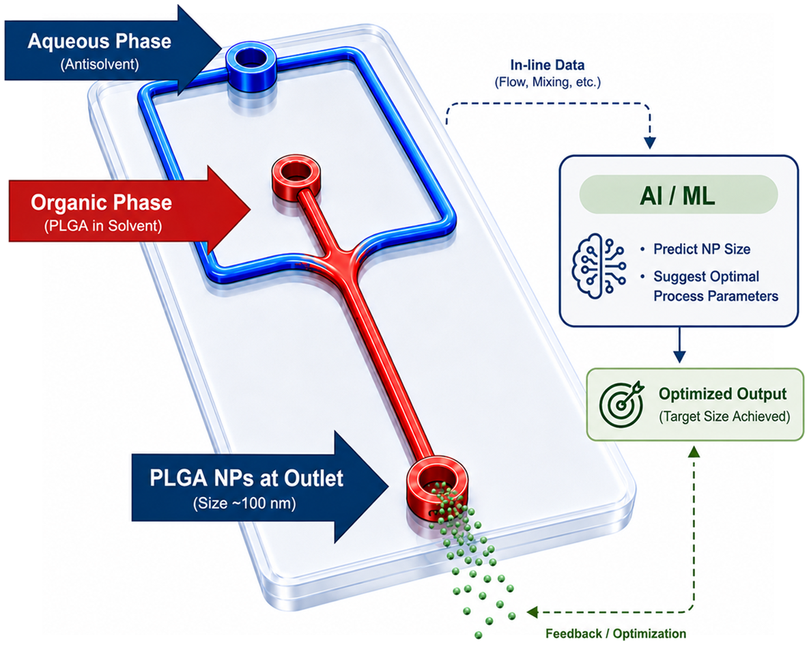

# PLGA: Reproducción y Extensión Física con ML Clásico

**Autor:** Santiago Benítez Sanabria · UDFJC  
**Referencia base:** Saeed et al. (2026), DOI: [10.1039/d6lc00612d](https://doi.org/10.1039/d6lc00612d)

## Contenido del repositorio

- `PLGA_reproduccion_gap.ipynb`: Notebook de Jupyter con la reproducción de los modelos de Machine Learning clásico, auditoría de solapamiento train/test, validación cruzada agrupada (GroupKFold), extrapolación geométrica y explicabilidad SHAP exacta.
- `dataset.csv`: Dataset experimental para la síntesis de nanopartículas de PLGA en microfluídica.
- `resultados/`: Directorio con tablas de métricas exportadas (`holdout.csv`, `cv_aleatoria.csv`, `comparacion.csv`, `gap.csv`, `extrapolacion.csv`, etc.) y gráficos generados (`paridad.pdf`, `gap_rmse.pdf`, `shap_summary.pdf`).

